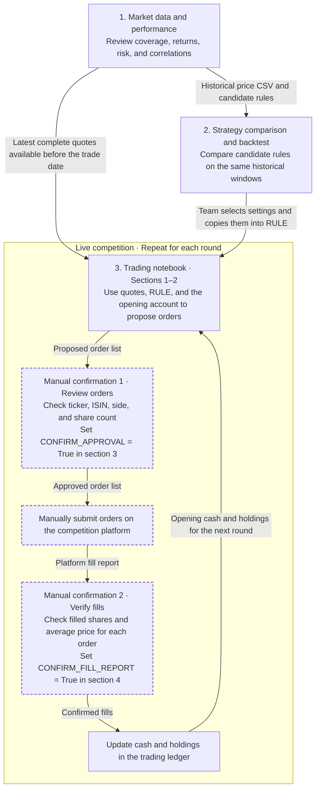

# QDC ETF Workflow Map

Run the [market data notebook](qdc-etf-data-refresh.ipynb), then the [backtest](qdc-etf-50-backtest.ipynb). Enter the chosen rule in the [trading notebook](qdc-etf-trading-workflow.ipynb) and rehearse before switching to `MODE = "live"`. Keep the same `qdc-trading-ledger.sqlite3` for every live round. See the [README](README.md) for setup and the full live-round checklist.
